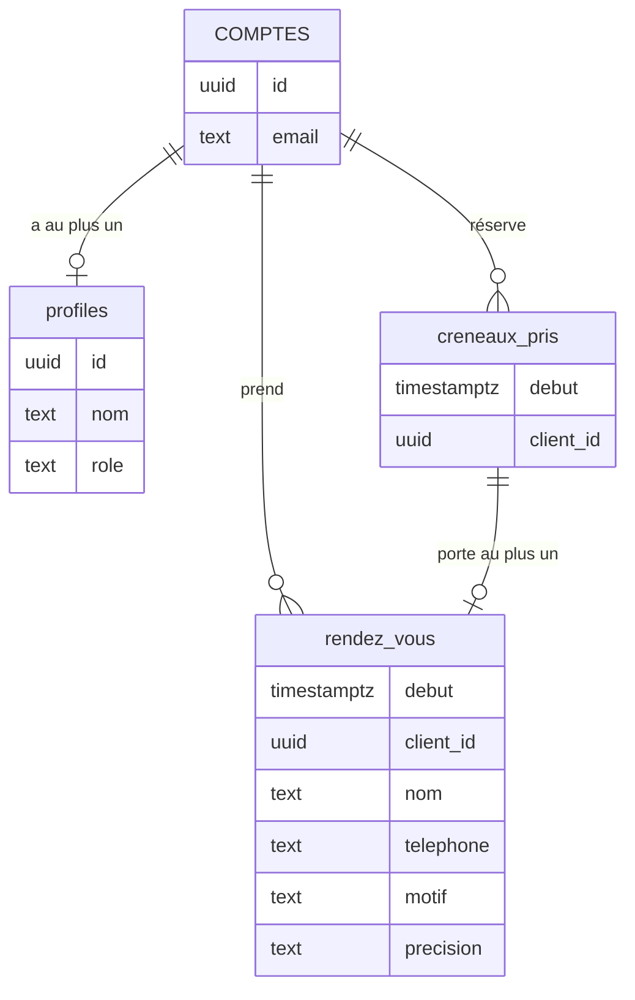

# Le schéma de la base de données

À ouvrir une fois votre propre base dessinée, à partir de `entretien.md` : comparez-la à celle-ci. C'est celle-ci que
vous construisez dans Supabase, puisque l'application cherche ces tables et ces colonnes sous ces noms exacts.

## Les tables

| Table | Colonnes | Ce que c'est |
|---|---|---|
| comptes | gérés par Supabase (`auth.users`) | les comptes créés depuis l'application, avec l'adresse e-mail et le mot de passe : on ne crée pas cette table, Supabase la tient |
| `creneaux_pris` | `debut` (date et heure, la clé), `client_id` (le compte qui a réservé) | le planning : les heures prises, sans aucune coordonnée, pour que tout le monde puisse le lire |
| `rendez_vous` | `debut` (date et heure, la clé), `client_id`, `nom`, `telephone`, `motif`, `precision` | le carnet : le rendez-vous et les coordonnées du client, que seuls le client et le coiffeur lisent |
| `profiles` | `id` (le compte), `nom`, `role` (`client` ou `coiffeur`) | ce qui dit qui est le coiffeur : une seule ligne, la sienne |

## Les liens

- **Un compte a au plus un profil (un à un)** : `profiles.id` est l'identifiant du compte. Seul le coiffeur en a un.
- **Un compte réserve plusieurs heures, et prend plusieurs rendez-vous (un à plusieurs)** : dans le planning comme dans
  le carnet, `client_id` désigne le compte.
- **Une heure du planning porte au plus un rendez-vous (un à un)** : `rendez_vous.debut` renvoie à `creneaux_pris.debut`,
  et c'est aussi la clé du carnet. Supprimer l'heure supprime le rendez-vous.

Pourquoi deux tables pour un rendez-vous : tout le monde doit voir les heures prises, personne ne doit voir qui les a
prises. L'heure va dans le planning, ouvert à tous ; les coordonnées vont dans le carnet, fermé.

## Ce que l'application en fait

- Elle lit le planning avant toute connexion, pour griser les heures prises.
- Pour réserver, elle ajoute d'abord l'heure au planning, puis le rendez-vous au carnet ; si le carnet refuse, elle
  retire l'heure. Pour annuler, elle supprime le rendez-vous, puis l'heure.
- Dans les deux tables, elle remplit elle-même `client_id` avec le compte connecté.
- Elle ne lit pas `profiles` : c'est la base de données qui s'en sert, pour reconnaître le coiffeur.
- Elle ne trie rien : **Mes rendez-vous** affiche ce que la base rend à la personne connectée. Si la base rend tout,
  chaque client voit tout.
